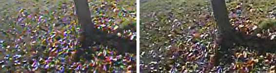
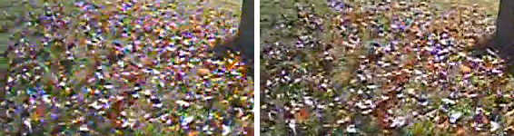
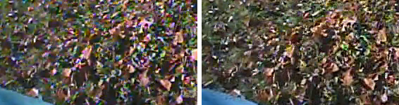

# FPV DVR Cleaner for BetaFPV Air camera

A Windows batch script that uses FFmpeg to clean up analog FPV goggle DVR footage. Tuned for the BetaFPV Air camera (16:9).
Also includes general version for tinywhoop cameras

Tweaking the script to suit your camera and DVR quality is recommended, and it's possible to have Claude code refine the script for you

Left is raw DVR, right is cleaned. (Air Cam)

## What it does

- Removes rainbow false color and chroma noise without blurring detail ( Air Cam version )
- Light sharpening
- Fixes the aspect ratio so 16:9 footage doesn't play back squished (keeps the original 720x480)
- Encodes to HEVC, falling back to H.264. Files end up roughly half the size of the original. ( Depending on CRF )
- Adds a silent audio track so Telegram doesn't treat the clip as a GIF ( and so your ears don't get raped )
- Portable: no install or admin rights needed

## Usage

I usually leave the script in my DCIM folder of my goggles so I can use it no matter whose computer I'm plugged into

1. Download an FFmpeg build for Windows that includes libx265 (e.g. from [gyan.dev](https://www.gyan.dev/ffmpeg/builds/)).
2. Put `ffmpeg.exe` and `ffprobe.exe` in the same folder as the script. (or just have FFMPEG installed)
3. Double-click the script to process every video in its folder, or drag clips onto it.

Output is saved next to each original as `<name>-opt.mp4`. Settings are at the top of the `.bat` if you want to tweak them.
